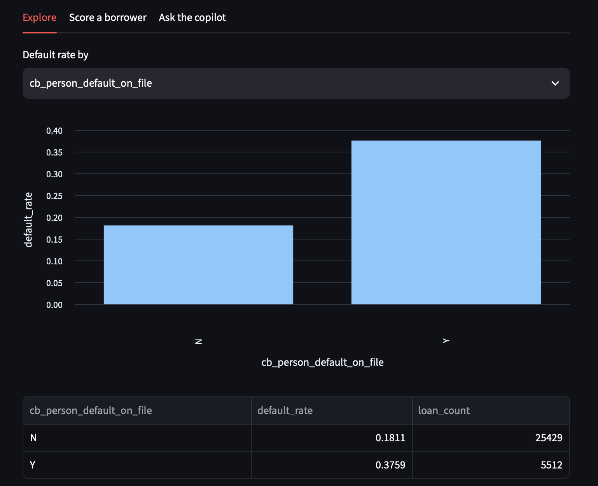
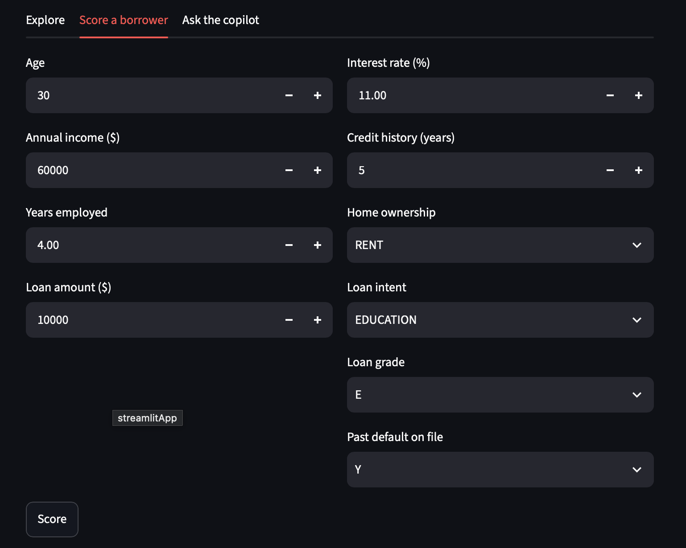

# Credit Risk Default Analysis and Copilot

An end-to-end credit risk project: SQL cleaning and aggregation, logistic regression for inference (statsmodels) and prediction (scikit-learn), and a Streamlit app with an LLM copilot that answers questions by calling my analysis functions.

**Live app:** https://credit-risk-default-analysis-klxhzf8ttfysvslcqws2gg.streamlit.app/




## Business Problem
Lenders need to know which borrower and loan characteristics predict default, so pricing and approval decisions rest on evidence. This project analyzes 32,581 loan records to find those drivers and make them explorable.

## Dataset
Credit Risk Dataset on Kaggle ([link]), licensed CC0. 12 columns covering borrower profile, loan details, and a default flag (`loan_status`).

## Tools
- **SQL (SQLite):** cleaning, outlier removal, default rate by segment
- **Python (pandas, statsmodels, scikit-learn):** modeling and evaluation
- **Streamlit:** interactive app
- **Gemini API:** natural language copilot using tool calling

## Method
1. **Cleaning (SQL):** removed 5 rows with ages above 100, and rows where age minus employment length was under 16 (impossible work histories). 30,941 rows remained.
2. **Segment analysis (SQL):** default rate by loan grade, loan intent, and home ownership.
3. **Phase 1, statsmodels:** logistic regression on grade, income, and loan amount, with odds ratios.
4. **Phase 2, scikit-learn:** all features one-hot encoded, missing interest rates filled with the median, 80/20 train/test split, standardized features, logistic regression.
5. **App:** three tabs (Explore, Score a borrower, Ask the copilot).

## Key Findings
- Default rate climbs with every grade: A 9.5%, B 15.9%, C 20.2%, D 59.1%, E 64.8%, F 70.1%, G 98.3%.
- Renters default far more often than owners (31.0% vs 7.0%). Borrowers with a past default on file default at 37.6% vs 18.1% without.
- Odds of default vs grade A (controlling for income and loan amount): B 1.6x, C 2.2x, D 14x, E 20x, F 27x. Grade G is too unstable to quote (only 60 loans).
- Higher income lowers default odds, and larger loans raise them.

## Model Performance (test set, 6,189 loans)
| Metric | Value |
|---|---|
| Accuracy | 86.8% |
| Baseline (always predict no default) | about 78% |
| Precision, default class | 0.78 |
| Recall, default class | 0.55 |

The model beats the baseline, but it catches only about 55% of real defaults (748 caught, 609 missed). In lending, missed defaults are the costly error, so a lender would likely lower the decision threshold to trade precision for recall.

## The Copilot
Questions typed in the app go to Gemini, which chooses from three tools I wrote: `default_rate_by`, `score_borrower`, and `top_risk_factors`. My code runs the tool and returns the result, and the model summarizes it. Guardrails: a whitelist of allowed columns, input validation on borrower fields, a cap of 5 tool rounds per question, and a rule that the model may only state numbers returned by a tool.

## Limitations
- Public dataset and a simple linear model, not a production credit model.
- Grade G has only 60 loans, so its estimates are unreliable.
- Missing interest rates were filled with the median before the train/test split, which is a minor form of leakage.
- Scikit-learn coefficients are on standardized features, so they are not comparable to the raw-unit statsmodels coefficients.
- The copilot depends on a third-party API and may be slow or rate limited. The free host also sleeps when idle, so the first load can take a few seconds.

## Run Locally
```
pip install -r requirements.txt
streamlit run app.py
```
Create `.streamlit/secrets.toml` with `GEMINI_API_KEY = "your-key"` to enable the copilot tab.

## Files
- `credit_risk_analysis.ipynb`: full analysis (SQL, statsmodels, scikit-learn)
- `app.py`, `tools.py`, `agent.py`: Streamlit app, analysis tools, agent loop
- `model.pkl`, `scaler.pkl`, `columns.pkl`: saved model artifacts
- `credit_risk.db`: cleaned SQLite database

## Next Steps
- Tune the decision threshold and try class weights or a tree-based model
- Fit the imputer on training data only
- Add confidence intervals for small segments
